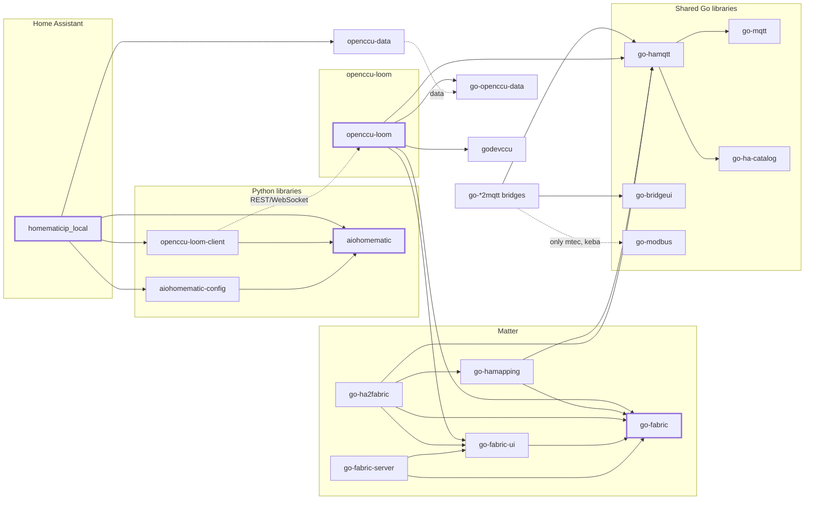

# Hi, I'm SukramJ 👋

I build open-source software for the **smart home**: Homematic and Homematic IP, Matter, and local device bridges to MQTT.

## Where to start

| You want to … | Start here |
|---|---|
| 🏠 Use Homematic in Home Assistant with the integration | [homematicip_local](https://github.com/SukramJ/homematicip_local) |
| 🧵 Use Homematic through MQTT, REST, Matter or Node-RED, with or without Home Assistant | [openccu-loom](https://github.com/SukramJ/openccu-loom) |
| 🔗 Embed or run Matter in Go | [go-fabric](https://github.com/SukramJ/go-fabric) |
| 🧑‍💻 Talk to Homematic from your own Python code | [aiohomematic](https://github.com/SukramJ/aiohomematic) |
| 🔌 Bring a single device to MQTT | one of the [bridges](#bridges) |

With the integration installed, please report everything in `homematicip_local`, whichever connection you use. If the cause is elsewhere, I move the issue.

## Projects

**Homematic in Home Assistant**
[homematicip_local](https://github.com/SukramJ/homematicip_local) · [homematicip-local-frontend](https://github.com/SukramJ/homematicip-local-frontend) (cards and panel)

**Homematic libraries**
[aiohomematic](https://github.com/SukramJ/aiohomematic) · [aiohomematic-config](https://github.com/SukramJ/aiohomematic-config)

**openccu-loom**
[openccu-loom](https://github.com/SukramJ/openccu-loom) · [openccu-loom-client](https://github.com/SukramJ/openccu-loom-client) · [node-red-contrib-openccu-loom](https://github.com/SukramJ/node-red-contrib-openccu-loom)

**Homematic data and testing**
[openccu-data](https://github.com/SukramJ/openccu-data) · [go-openccu-data](https://github.com/SukramJ/go-openccu-data) · [godevccu](https://github.com/SukramJ/godevccu)

**Matter**
[go-fabric](https://github.com/SukramJ/go-fabric) · [go-fabric-server](https://github.com/SukramJ/go-fabric-server) · [go-fabric-ui](https://github.com/SukramJ/go-fabric-ui) · [go-ha2fabric](https://github.com/SukramJ/go-ha2fabric) · [go-hamapping](https://github.com/SukramJ/go-hamapping)

**Bridges** (independent, each with its own issues)
[go-mtec2mqtt](https://github.com/SukramJ/go-mtec2mqtt) · [go-keba2mqtt](https://github.com/SukramJ/go-keba2mqtt) · [go-zendure2mqtt](https://github.com/SukramJ/go-zendure2mqtt) · [go-unifi2mqtt](https://github.com/SukramJ/go-unifi2mqtt) · [go-homeconnect2mqtt](https://github.com/SukramJ/go-homeconnect2mqtt) · [go-daikin2mqtt](https://github.com/SukramJ/go-daikin2mqtt) · [go-raumfeld-connect](https://github.com/SukramJ/go-raumfeld-connect)

**Shared Go libraries**
[go-mqtt](https://github.com/SukramJ/go-mqtt) · [go-hamqtt](https://github.com/SukramJ/go-hamqtt) · [go-ha-catalog](https://github.com/SukramJ/go-ha-catalog) · [go-modbus](https://github.com/SukramJ/go-modbus) · [go-bridgeui](https://github.com/SukramJ/go-bridgeui)

## How it fits together

Simplified. Solid arrows are package dependencies, dashed arrows are runtime or data relations.

